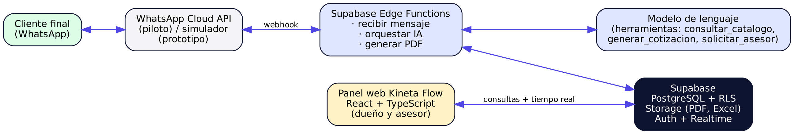
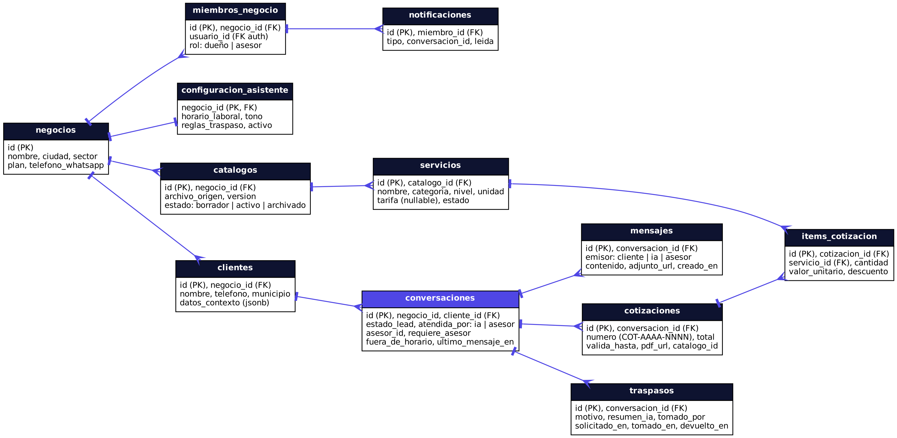

# Kineta Flow

Asistente de inteligencia artificial que responde y cotiza por WhatsApp para pymes colombianas, con un panel web donde el dueño administra su catálogo, ve lo que atendió el asistente y su equipo toma las conversaciones que requieren a una persona.

Proyecto final del curso **From Ideas to Prototypes** — Universidad del Rosario, 2026.
Equipo: Santiago Ángel y Diego Rincón. Producto derivado de Kineta Lab.

> Este prototipo usa **datos de demostración**: los negocios (Monitorías Teorema y Castillo Solar) y sus clientes son ficticios y corresponden a los perfiles de usuario del proyecto. El canal de WhatsApp se representa con un simulador.

## Qué resuelve

| Historia | Pantalla | Qué se puede hacer |
|---|---|---|
| HU-01 · Marcia carga sus tarifas | **Catálogo y precios** | Subir un Excel, ver la vista previa con alertas de servicios sin tarifa y activar el catálogo. El asistente solo cotiza con el catálogo activo; la base de datos rechaza cotizar un servicio sin tarifa. |
| HU-02 · Marcia ve lo que atendió el asistente | **Inicio** | Conversaciones atendidas, atendidas fuera de horario, cotizaciones enviadas y tiempo promedio de respuesta; selector de rango y gráfica por día dentro/fuera de horario. |
| HU-03 · Alejandro filtra sus leads | **Leads** | Contadores por estado, panel de filtros con Limpiar/Aplicar, etiqueta del filtro activo removible y contador de resultados. |
| HU-04 · Alejandro toma una conversación | **Conversaciones** | Bandeja «Requieren asesor», alerta en tiempo real, botón «Tomar conversación» que pausa la IA solo en ese chat, y resumen generado para el asesor. |
| Demostración | **Simulador WhatsApp** | Escribir como cliente final: precios, cotización en PDF, casos delicados y traspaso a un asesor. |

## Cuentas de prueba

Contraseña de todas: `KinetaFlow2026`

| Correo | Rol |
|---|---|
| marcia@demo.kinetaflow.co | Dueña · Monitorías Teorema |
| laura@demo.kinetaflow.co | Asesora · Monitorías Teorema |
| alejandro@demo.kinetaflow.co | Dueño · Castillo Solar |
| camilo@demo.kinetaflow.co | Asesor · Castillo Solar |

## Arquitectura



- **Manual de marca:** `docs/manual_de_marca.html`.
- **Interfaz:** React 18 + TypeScript + Vite + Tailwind CSS (tipografía Poppins, paleta del manual de marca).
- **Backend:** Supabase — PostgreSQL con seguridad a nivel de fila (cada negocio solo ve sus datos), autenticación, tiempo real.
- **Asistente:** `src/lib/asistente.ts` + función en la nube `supabase/functions/interpretar-mensaje`. No responde preguntas abiertas: solo actúa con tres herramientas (consultar catálogo, generar cotización, solicitar asesor), en línea con la política de WhatsApp Business de 2026 que prohíbe asistentes de propósito general. Claude Haiku interpreta cada mensaje y elige la herramienta y sus parámetros; el código valida la decisión contra el catálogo y escribe el precio. Las reglas del dueño se aplican antes del modelo, y si el modelo falla o tarda más de 12 s se usa un motor de reglas en español. Cada mensaje guarda en `mensajes.motor` qué motor lo resolvió. La clave se configura como secreto de la función (`ANTHROPIC_API_KEY`), nunca en el navegador.
- **Cotizaciones:** PDF generado con jsPDF a partir de los datos guardados (`src/lib/pdf.ts`).

## Base de datos



12 tablas: `negocios`, `miembros_negocio`, `configuracion_asistente`, `catalogos`, `servicios`, `clientes`, `conversaciones`, `mensajes`, `cotizaciones`, `items_cotizacion`, `traspasos`, `notificaciones`.

Reglas que viven en la base de datos y no solo en la interfaz:
- Un solo catálogo activo por negocio (índice único parcial) y activación atómica (`activar_catalogo`).
- Un servicio sin tarifa no puede quedar como «listo» (restricción `check`), y un disparador impide cotizarlo o cotizar con un catálogo que no esté activo.
- Solo el dueño puede crear o activar catálogos y cambiar la configuración (políticas restrictivas).
- Los indicadores del panel se calculan en `resumen_negocio(negocio, días)`.

Esquema en `supabase/migrations/` y datos de demostración en `supabase/seed/`.

## Ejecutar en local

```bash
npm install
cp .env.example .env   # completar VITE_SUPABASE_URL y VITE_SUPABASE_ANON_KEY
npm run dev
```

Para una base nueva: aplicar los archivos de `supabase/migrations/` en orden y luego los de `supabase/seed/`.

## Estructura

```
src/
  lib/asistente.ts      motor del asistente (3 herramientas)
  lib/pdf.ts            cotización en PDF
  lib/formato.ts        formatos, horario laboral, estados del lead
  context/Sesion.tsx    sesión, negocio, rol y configuración
  components/           Layout (barra lateral, notificaciones), marca, burbujas de chat
  pages/                Inicio, Catalogo, Leads, Conversaciones, Configuracion, Simulador, Login
supabase/
  migrations/           esquema, funciones y permisos
  seed/                 datos de demostración
docs/                   diagramas
```
